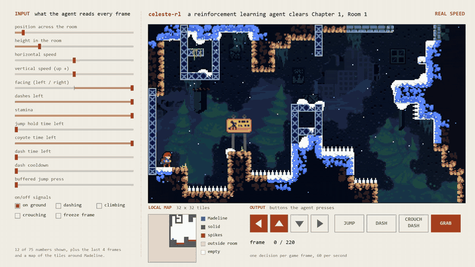
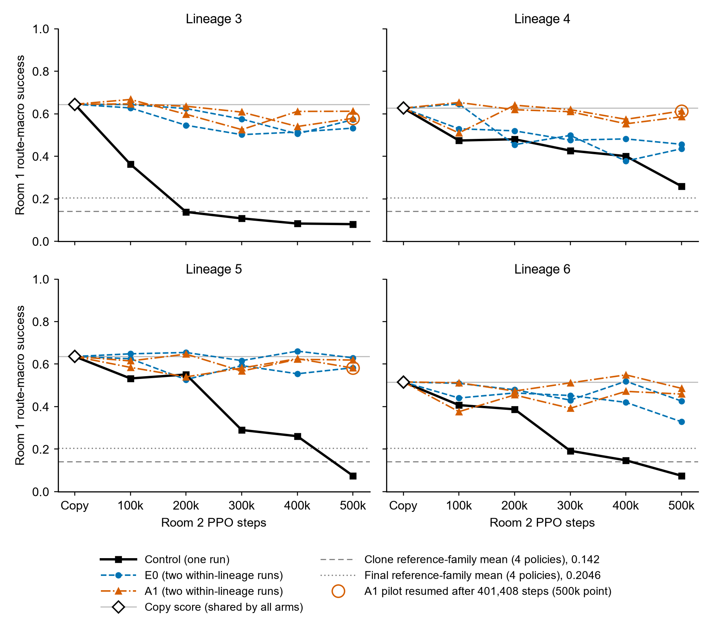

# celeste-rl

**Continual reinforcement learning research, using [Celeste](https://www.celestegame.com/) as the testbed.** When
an agent that has learned one task is trained on a second, how much of the first does it lose, and how should that
loss be measured? This project studies the question on the first two rooms of Chapter 1, with an agent that reads
game state and plays on unmodified game physics.

<p align="center">
  
</p>

*The agent clearing Chapter 1, Room 1 in 220 frames, at real speed and then replayed at one-third speed. Left: some
of the game-state numbers it reads every frame. Below the game: a map of the nearby tiles and the buttons it presses.*

## In short

- **The problem.** Neural network policies tend to lose old skills when they are trained on new ones, which the
  field calls catastrophic forgetting. Celeste's rooms make a clean test: each room is a distinct task with a clear
  success criterion, the controls and observations are shared, and the game is deterministic, so old-room skill can
  be scored on the same start states at every stage of training.
- **The main finding.** A policy that had learned Room 1 was taught Room 2, first by imitation and then with PPO,
  a standard reinforcement learning algorithm. The imitation step cost 12 to 14 percentage points of Room 1
  success. Under the standard PPO recipe, Room 2 training then cut a further 37 to 56 points in all four lineages,
  and three of the four finished slightly below the weakest measured policy that had never seen Room 1. Two
  variants, one with PPO's entropy bonus switched off and one anchored to the original Room 1 behaviour, lost much
  less: the largest loss in any of their 16 runs was smaller than the smallest loss under the standard recipe, and
  their median Room 2 performance was not lower. These comparisons are descriptive (four lineages, with the standard
  recipe from an earlier campaign), not a controlled effect.
- **The measurement point.** How large forgetting looks depends on which checkpoint is the baseline, which start
  states are scored and what the loss is divided by. The report works through cases where those choices change the
  interpretation.
- **The engineering underneath.** A frame-exact interface to the unmodified game that runs at about 2,600 frames
  per second, checked frame by frame against the reference tooling and covered by 469 unit tests.

## Technical report

**[Measuring competence and forgetting across imitation and PPO adaptation: a Celeste case study](docs/technical-report.md)**
<br>Muhammad Shihaab Alam. Version 1.0, 9 October 2026.

[](docs/figures/technical-report/F2-room1-checkpoint-trajectories.svg)

*Room 1 success of each policy while it trains on Room 2, one panel per lineage. The standard recipe (black) loses
most of its Room 1 skill; the no-entropy (E0, blue) and donor-anchor (A1, orange) variants lose much less. The
dashed and dotted lines are the mean Room 1 scores of policies that never saw Room 1.*

| Median across runs | Standard recipe (4 runs) | No entropy bonus, E0 (8 runs) | Anchor to Room 1 behaviour, A1 (8 runs) |
|---|---:|---:|---:|
| Share of Room 1 skill lost during Room 2 PPO | 0.87 | 0.18 | 0.06 |
| Room 2 route-macro success on its start set | 0.806 | 0.862 | 0.847 |
| Room 2 clears from the normal start, out of 50 | 42.5 | 49 | 48 |

"Share of Room 1 skill lost" is the drop in Room 1 success during Room 2 PPO, divided by how far the Room 1 policy
scored above policies that never saw Room 1. All 20 runs come from four lineages that share one starting network,
so the independent sample size is four. Section 2.3 of the report explains what counts as an independent run.

To cite the report:

```bibtex
@misc{alam2026celeste,
  author = {Alam, Muhammad Shihaab},
  title  = {Measuring competence and forgetting across imitation and {PPO} adaptation: a {Celeste} case study},
  year   = {2026},
  month  = oct,
  note   = {Technical report, version 1.0},
  url    = {https://github.com/shihaab453/celeste-rl/blob/technical-report-v1.0/docs/technical-report.md}
}
```

## Key terms

- **Route-macro success.** Each room's evaluation set holds frozen start states grouped into routes (Room 1: 200
  starts on 11 routes). Route-macro success averages the success rate over routes with equal weight, so a heavily
  sampled route cannot dominate the score. A start succeeds when the episode leaves the room.
- **Canonical and varied starts.** The canonical start is the room's normal spawn point. Varied-start training
  begins episodes from states sampled along routes through the room.
- **Behaviour cloning.** Learning by imitating recorded demonstrations. Here the demonstrations come from an
  automated search, not human play.
- **Donor, copy and lineage.** A donor is a Room 1 policy before any Room 2 training. Its copy is a network fitted to
  imitate both the donor's Room 1 behaviour and the Room 2 demonstrations, and Room 2 PPO starts from the copy. A
  lineage is one donor and everything trained from it.

## How the agent learned the rooms

Before forgetting could be studied, the agent had to learn each room. These are the earlier experiments the
retention work builds on.

**Demonstration-assisted varied-start training improves Room 1 generalisation, but has not yet met the declared
99% reliability target.** On a replacement frozen
set of 200 unique states from 11 search-route clusters, six matched fine-tuning seeds achieved a 74.8%
route-macro success rate with varied starts and 52.2% with canonical starts. The predeclared paired difference
was **+22.6 percentage points**, with a crossed seed-route 95% bootstrap interval from +6.7 to +43.5 points and
an exact two-sided paired sign-flip p-value of 0.03125. Varied starts won in all six matched seeds and on all
eleven route-level descriptive comparisons.

**That benefit did not replicate in Room 2.** The same matched design in
[Room 2](docs/room2-matched-finetuning.md) found no evidence of a varied-start benefit: canonical-start
training scored 86.8% route-macro success and varied-start training 80.9%, a paired difference of -5.8 points
with a 95% crossed seed-route interval from -18.7 to +3.4 points and exact p = 0.50. The varied-start run for
seed 25 collapsed during training. A later training-side replication found that canonical-start runs collapse
too (5 of 14 runs from the same clone); see [Room 2 training stability](docs/room2-training-stability.md). As a
descriptive observation, not a sensitivity analysis, seeds 20 to 24
averaged a 0.0 point difference; the six-seed result above is the one that counts. Both arms remain below the
roadmap's 99% held-out bar.

The fixed canonical start remains a poor measure of generalisation: two policies that scored 98.0% and 98.5%
there scored 59.7% and 84.6% on the earlier diagnostic state set. Chapter 1 has 20 rooms; Rooms 1 and 2 have
been attempted so far.

The experiment reports, in order. The negative one came first and matters as much:

| Report | Result |
|---|---|
| [Phase 3: without demonstrations](docs/phase3-unshaped-baseline.md) | **0 clears** in 50,369 episodes over three seeds and six million transitions, with the diagnosis of why |
| [Phase 3B: with demonstrations](docs/phase3b-demonstration-comparison.md) | **Varied-start fine-tuning beats canonical-start fine-tuning by 22.6 points in Room 1** under the predeclared matched, route-cluster-aware analysis |
| [Room 2: matched fine-tuning](docs/room2-matched-finetuning.md) | **No evidence of a varied-start benefit**: B minus A -5.8 points, 95% crossed seed-route interval -18.7 to +3.4, exact paired p = 0.50; one of six varied-start runs collapsed during training; canonical-start runs can collapse too ([training stability](docs/room2-training-stability.md)) |
| [Room 1 retention pilot](docs/room1-retention-pilot.md) | **Teaching a Room 1 policy Room 2 by imitation on Room 2 alone erased almost all of its Room 1 skill**, the first sign of the forgetting the technical report measures |

The project committed in advance to attempting the room without demonstrations first, on a fixed budget, so
that the result could be described honestly either way. That attempt failed, and the report says so and
explains what was measured to work out why: the policy never left near-uniform play, the critic learned the
shaped value function exactly, and the reward left very little raw advantage variation among failures. PPO
normalises those advantages, so this is evidence of weak signal rather than literally zero policy gradient.

Confidence intervals are reported where their sampling assumptions are defensible. The held-out comparison
resamples matched training seeds and complete route clusters rather than treating every prefix as independent.

### The interface underneath

No learning happens until the environment is correct, fast enough for millions of frames, and stable enough to
run unattended.

| What | Result |
|---|---|
| Step speed | **About 2,600 frames per second** including resets, up from about 30 per second over CelesteTAS's HTTP interface (about 85x) |
| Physics fidelity | Complete game state identical frame by frame to the reference interface, and position, speed, state, room and timer identical to normal-speed TAS playback on fixed traces covering a room transition with 7 dashes (376/376 frames), spike deaths and respawns (263/263) and a pause-menu loading scene (287/287) |
| Stability | 30-minute run: 4,853,400 steps, 16,178 episodes, 808 of 808 periodic replay checks identical, no errors |
| Robustness | 13 live fault checks pass, including 100 rounds of replacing a client connection mid-reset and a client that stops reading replies |
| Inputs | Input bindings checked in the game (30 of 30 checks), including both bindings for jump, dash, crouch dash and grab, dash-only and move-only directions, and pause-menu confirm and cancel |
| Memory | Found and fixed a render target leak of 2 to 6 MB per reset (8 GB in 4 minutes); memory now stays flat |
| Provenance | Every training run records its commit, the game build's file hashes and the schema version, and refuses to start if any of them drifts |
| Tests | 469 unit tests, plus live checks against the game |

## How it works

The game runs with [Everest](https://everestapi.github.io/) (mod loader), [CelesteTAS](https://github.com/EverestAPI/CelesteTAS-EverestInterop) (frame-exact input playback) and [Speedrun Tool](https://github.com/DemoJameson/Celeste.SpeedrunTool) (savestates), in an isolated copy of the game.

**Reference bridge (Python, HTTP).** CelesteTAS has no endpoint that accepts inputs, so `celeste_rl/bridge.py` writes inputs into the TAS file CelesteTAS is playing. The file always ends at the frame the game is paused on, and the bridge appends exactly one input line per step. CelesteTAS refuses to advance past the end of the file until it has re-read it, so an input can never land on the wrong frame or be played twice. This path is limited by the game's 60 Hz clock to about 30 steps per second, and is used as the correctness reference.

**Lockstep bridge (C# Everest mod + Python client).** `mod/CelesteRLLockstep` hooks CelesteTAS's playback loop. When every input has been played, it sends the resulting state to Python over a local socket and waits for the next input, instead of waiting for the next 60 Hz tick. Each frame still runs through CelesteTAS's normal input playback and the game's normal update with the normal frame length; only the waiting changes. `celeste_rl/lockstep.py` exposes the same `reset()` and `step()` as the reference bridge.

**Resets** restore a savestate taken one frame before the episode start, which takes about 4 ms.

**Session safety.** Each connection is owned by a numbered session: replies only go to the connection that sent the command, a new connection must reset before stepping, and every pending command has a deadline. Any timeout, malformed reply or error ends the Python session, and recovery always goes through a full reset.

**Loading scenes.** If an input starts a loading scene, the mod lets loading finish before replying, so every observation is a frame the agent can act on.

## Verification

- `scripts/transition_check.py` plays a fixed input trace four ways (reference bridge, lockstep bridge, lockstep with 5, 50 and 500 ms client delays, and plain TAS playback at normal speed exported frame by frame) and requires them to agree, with full coverage of every expected frame.
- `scripts/lockstep_fault_check.py` misbehaves on purpose against the running game: stepping before reset, wrong start frames, replacing connections at random points during a reset, disconnecting mid-step, and clients that never read replies.
- `scripts/binding_audit.py` checks that each input binding does what it should in the game.
- `scripts/soak_test.py` and `scripts/memory_probe.py` run long sessions and isolate memory behaviour. The memory probe found that Everest's dash-trail render targets were never freed when a savestate replaced the level, and the mod now releases them before each reset.

## Ground rules

- **Physics are never modified.** Savestates and fast stepping are training scaffolding and will not be used in any demonstrated run.
- **Legal inputs only.** The agent can use exactly the bindings in the game's controls menu. Input lines are validated in both Python and the mod, so no TAS command can be injected.
- **State-based observations.** The agent reads game state (position, velocity, room geometry and so on), not pixels. This will be documented precisely alongside results.
- **No game files** are included in this repository.

## Open questions

The report's conclusion lists what stronger identification of forgetting and its remedies would need:

- independent lineages beyond one behaviour-cloning network;
- more than one copy fit per donor;
- an exposure measure defined along trajectories, with subgroup reference values;
- standard-recipe and variant runs from the same campaign;
- update-level records of PPO training.

The earlier engineering plan, from the interface to two-room play, is in [`docs/planning/roadmap.md`](docs/planning/roadmap.md).

## Repository layout

| Path | Contents |
|---|---|
| `celeste_rl/` | Reference bridge, lockstep client, game launcher, export comparison |
| `mod/CelesteRLLockstep/` | The Everest mod (C#) |
| `scripts/` | Environment check, live verification, fault, binding, soak and memory checks, route search |
| `tests/` | Unit tests and fixed input traces |
| `config/` | Campaign definitions for training and evaluation runs |
| `docs/` | The technical report, experiment reports and figures |
| `docs/results/` | Machine-readable result files behind the reports |
| `docs/planning/` | Phased roadmap, environment spec and the first feasibility measurements |
| `experiments/`, `results/` | Early PyTorch exercises (tensors, a hand-written training loop fitting `sin(x)`) |

## Setup

Requires Windows, the Steam version of Celeste, and a separate copy of the game with Everest 1.6531.0, CelesteTAS 3.47.1 and Speedrun Tool 3.27.21 installed. Game files are not included.

The RL environment uses Python 3.12.13 in `.venv-rl`, created with [uv](https://docs.astral.sh/uv/):

```bash
uv python install 3.12.13
uv venv .venv-rl --python 3.12.13 --seed
uv pip sync requirements-rl.lock --python .venv-rl/Scripts/python.exe --extra-index-url https://download.pytorch.org/whl/cu130 --index-strategy unsafe-best-match
.venv-rl/Scripts/python.exe scripts/check_env.py
```

Pinned dependencies: PyTorch 2.14.0 (CUDA 13.0), Gymnasium 1.3.0, Stable-Baselines3 2.9.0. `check_env.py` verifies a real GPU calculation and trains PPO on CartPole briefly as a smoke test. Run the unit tests with `.venv-rl/Scripts/python.exe -m unittest`.

Build the mod into the game copy with the .NET SDK:

```bash
cd mod/CelesteRLLockstep
dotnet build -c Release -p:GameDir=<path to the game copy> -p:RefsDir=<folder with the CelesteTAS DLLs>
```

`RefsDir` holds `CelesteTAS-EverestInterop.dll`, `StudioCommunication.dll` and `MemoryPack.Core.dll` from the `bin` folder of the CelesteTAS release. The build installs the mod into the game copy's `Mods` folder.

To change Python dependencies, edit `requirements-rl.in`, delete `requirements-rl.lock` (an existing lock file makes uv keep old versions), then regenerate it:

```bash
uv pip compile requirements-rl.in -o requirements-rl.lock --python-version 3.12 --python-platform windows --extra-index-url https://download.pytorch.org/whl/cu130 --index-strategy unsafe-best-match --generate-hashes --emit-index-annotation
```

Do not use `uv sync` or `uv run` in this repository: uv's project mode manages a venv named `.venv` and would rebuild the separate Python 3.14 environment used by `experiments/`.

## License

The code and documentation in this repository are released under the [MIT License](LICENSE). Celeste, its
artwork and its game files belong to their respective owners and are not covered by this license; gameplay
footage appears here for illustration only.
